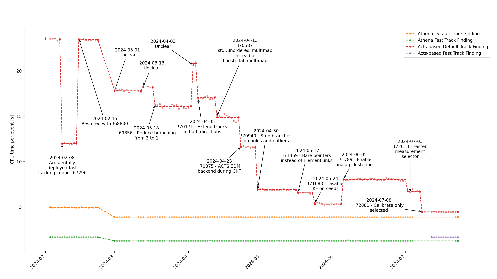

# SPOTTER

Generates plots from SPOT (https://atlaspmb.web.cern.ch/atlaspmb/) which help to keep track of the developments for reconstruction chains and their impact on CPU and memory consumption.

Originally from https://github.com/andiwand/cern-scripts/blob/858eb78de0548021836913b861e0aa2c50bf51e1/notebooks/2024-05-28_spot-graph.ipynb.

Installing the dependencies (use a virtual environment)
```bash
pip install -r requirements.txt
```

How to run it:
```bash
# run the fetching
python -m spotter.fetcher

# run the plotting
python -m spotter.plotter
```

Afterwards you should find a couple of PNG and PDF files in the current working directory.

Example:

