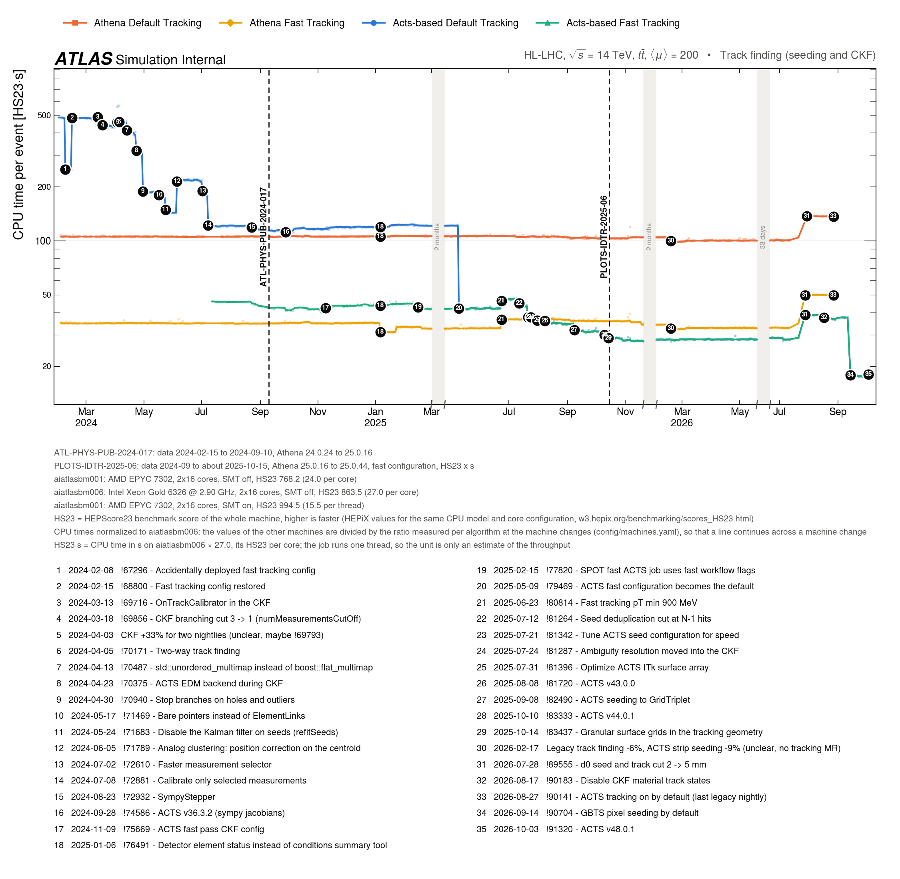

# SPOTTER

Generates plots from SPOT (https://atlaspmb.web.cern.ch/atlaspmb/) which help to keep track of the developments for reconstruction chains and their impact on CPU and memory consumption.

Originally from https://github.com/andiwand/cern-scripts/blob/858eb78de0548021836913b861e0aa2c50bf51e1/notebooks/2024-05-28_spot-graph.ipynb.

Installing the dependencies (use a virtual environment)
```bash
pip install -r requirements.txt
```

How to run it:
```bash
# run the fetching
python -m spotter.fetcher

# run the plotting
python -m spotter.plotter
```

Afterwards you should find a couple of PNG and PDF files in the current working directory.

The fetcher has two steps:

1. The download step reads the log index of each SPOT job and downloads the logs that are not in `data/raw/` yet. `data/raw/<tag>.csv` has one row for each component of each log, and `data/raw/<tag>_logs.csv` has one row for each downloaded log.
2. The extract step computes the points of each flavor from the raw tables and writes `data/<flavor>_<point>.csv`.

```bash
# only compute the points again, for example after a change to a mask
python -m spotter.fetcher --skip-download

# download all logs again, for example after a change to the step
python -m spotter.fetcher --refetch
```

`config/fetcher.yaml` explains the `map`, `sum`, `optional`, `mask` and `sources` options.

The plotter can cut quiet periods out of the x axis. A quiet period is a date range in which no plotted series changes by more than a relative threshold. The cuts never hide an annotation, a platform change or a move of a flavor between SPOT jobs.

`config/annotations.yaml` holds the annotations for all plots. Each annotation lists the flavors and the points that it affects, so a change appears on every plot that shows one of them. The plots also mark these changes from the data:

- a change of the platform (for example `el9-gcc15`), with a solid gray line
- a change of the SPOT machine, with a dash-dot gray line
- a move of a flavor from one SPOT job to another, with a dotted line in the color of the flavor

`config/machines.yaml` holds the CPU model and the HS23 (HEPScore23) benchmark of each SPOT machine. The plots name the machine, its CPU and its HS23 below the x axis and at each machine change.

A plot config can set `log_y: true` for data that changes by more than a factor of about 10.

```bash
# use the axis cuts of the config (the default)
python -m spotter.plotter --config config/plot-trackfinding.yaml

# plot without axis cuts
python -m spotter.plotter --config config/plot-trackfinding.yaml --axis-cuts off

# compute the cuts from the data, and print them for the `axis_cuts` key of the config
python -m spotter.plotter --config config/plot-trackfinding.yaml --axis-cuts auto --suggest-axis-cuts --cut-threshold 0.05 --cut-min-days 60
```

Example:

